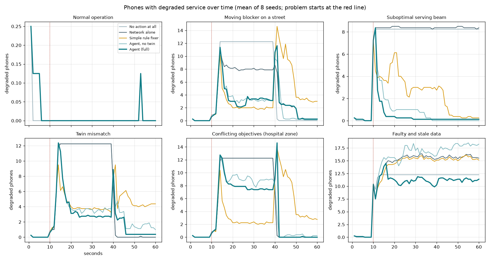

# Evaluation: six scenarios, five methods

Station Road, 8 seeds per scenario (phone positions and details vary by seed). Problems start at second 10; each run lasts 60 s. Scored against the simulator's hidden truth: a phone is degraded when its true clarity is 4 dB below its own normal and below 13 dB, or it gets under 80% of the data it wants.

- **degraded phone-s**: phones degraded x seconds while the problem lasts (lower is better)
- **after it ends**: degraded phone-seconds once a temporary cause (the bus) has gone; leftover changes that are never withdrawn show up here
- **made worse**: phone-seconds degraded under this method but not under the network alone
- **safety breaks**: an independent audit of limits and the protected hospital zone
- **asked a person**: escalations, including approval requests (a simulated operator approves after 5 s)

## Normal operation

| method            |   degraded phone-s | recovered   |   median recovery s |   still degraded at end |   after it ends (phone-s) |   made worse (phone-s) |   changes made |   safety breaks |   decision ms (max) |   undone |   asked a person |   false alarms | diagnosis right   |
|:------------------|-------------------:|:------------|--------------------:|------------------------:|--------------------------:|-----------------------:|---------------:|----------------:|--------------------:|---------:|-----------------:|---------------:|:------------------|
| No action at all  |                0   | 100%        |                   0 |                       0 |                         0 |                      0 |              0 |               0 |                   0 |      nan |              nan |            nan | nan               |
| Network alone     |                0.1 | 100%        |                   0 |                       0 |                         0 |                      0 |              0 |               0 |                   0 |      nan |              nan |            nan | nan               |
| Simple rule fixer |                0.1 | 100%        |                   0 |                       0 |                         0 |                      0 |              0 |               0 |                   3 |      nan |              nan |            nan | nan               |
| Agent, no twin    |                0.1 | 100%        |                   0 |                       0 |                         0 |                      0 |              0 |               0 |                   2 |        0 |                0 |              0 | 100%              |
| Agent (full)      |                0.1 | 100%        |                   0 |                       0 |                         0 |                      0 |              0 |               0 |                   3 |        0 |                0 |              0 | 100%              |

## Moving blocker on a street

| method            |   degraded phone-s | recovered   |   median recovery s |   still degraded at end |   after it ends (phone-s) |   made worse (phone-s) |   changes made |   safety breaks |   decision ms (max) |   undone |   asked a person |   false alarms | diagnosis right   |   twin error dB |
|:------------------|-------------------:|:------------|--------------------:|------------------------:|--------------------------:|-----------------------:|---------------:|----------------:|--------------------:|---------:|-----------------:|---------------:|:------------------|----------------:|
| No action at all  |              327   | 0%          |               nan   |                    12.2 |                       0   |                  115.6 |            0   |               0 |                   0 |    nan   |            nan   |            nan | nan               |           nan   |
| Network alone     |              221   | 38%         |                 7   |                     7.9 |                      18.5 |                    0   |            0   |               0 |                   0 |    nan   |            nan   |            nan | nan               |           nan   |
| Simple rule fixer |               75.6 | 75%         |                 5.5 |                     2   |                      91   |                  120.6 |           26.2 |               0 |                 103 |    nan   |            nan   |            nan | nan               |           nan   |
| Agent, no twin    |              110.2 | 50%         |                 7   |                     3.1 |                       3.8 |                   41.5 |            5.9 |               0 |                 173 |      3.1 |              1.2 |              0 | 88%               |           nan   |
| Agent (full)      |              105.8 | 62%         |                 7   |                     3.1 |                      18.8 |                   38.9 |            1.8 |               0 |                 415 |      0.5 |              2.9 |              0 | 88%               |             4.1 |

## Suboptimal serving beam

| method            |   degraded phone-s | recovered   |   median recovery s |   still degraded at end |   after it ends (phone-s) |   made worse (phone-s) |   changes made |   safety breaks |   decision ms (max) |   undone |   asked a person |   false alarms | diagnosis right   |   twin error dB |
|:------------------|-------------------:|:------------|--------------------:|------------------------:|--------------------------:|-----------------------:|---------------:|----------------:|--------------------:|---------:|-----------------:|---------------:|:------------------|----------------:|
| No action at all  |              411.5 | 0%          |                 nan |                     8.2 |                         0 |                    0.2 |            0   |               0 |                   0 |    nan   |            nan   |            nan | nan               |           nan   |
| Network alone     |              418.2 | 0%          |                 nan |                     8.2 |                         0 |                    0   |            0   |               0 |                   0 |    nan   |            nan   |            nan | nan               |           nan   |
| Simple rule fixer |              130.8 | 100%        |                  15 |                     0.2 |                         0 |                   25   |            9.8 |               3 |                   3 |    nan   |            nan   |            nan | nan               |           nan   |
| Agent, no twin    |               50.1 | 100%        |                   5 |                     0   |                         0 |                    0   |            3   |               1 |                 394 |      0.9 |              0.4 |              0 | 100%              |           nan   |
| Agent (full)      |               30.4 | 100%        |                   5 |                     0.1 |                         0 |                    0   |            1.9 |               0 |                 659 |      0   |              0.5 |              0 | 100%              |             2.7 |

## Twin mismatch

| method            |   degraded phone-s | recovered   |   median recovery s |   still degraded at end |   after it ends (phone-s) |   made worse (phone-s) |   changes made |   safety breaks |   decision ms (max) |   undone |   asked a person |   false alarms | diagnosis right   |   twin error dB |
|:------------------|-------------------:|:------------|--------------------:|------------------------:|--------------------------:|-----------------------:|---------------:|----------------:|--------------------:|---------:|-----------------:|---------------:|:------------------|----------------:|
| No action at all  |              327   | 0%          |                 nan |                    12.2 |                       0   |                    0.6 |            0   |               0 |                   0 |    nan   |            nan   |            nan | nan               |           nan   |
| Network alone     |              326.4 | 0%          |                 nan |                    12.2 |                       0.1 |                    0   |            0   |               0 |                   0 |    nan   |            nan   |            nan | nan               |           nan   |
| Simple rule fixer |              120.9 | 50%         |                   7 |                     3.2 |                      78.4 |                  109.8 |           21   |               0 |                  35 |    nan   |            nan   |            nan | nan               |           nan   |
| Agent, no twin    |              126.1 | 75%         |                   8 |                     3.8 |                      27.1 |                   77.2 |            6.2 |               0 |                 239 |      2.5 |              1.6 |              0 | 100%              |           nan   |
| Agent (full)      |              111.9 | 88%         |                  10 |                     2.6 |                      10.8 |                   51.9 |            3.2 |               0 |                 412 |      0.9 |              1.2 |              0 | 100%              |            10.8 |

## Conflicting objectives (hospital zone)

| method            |   degraded phone-s | recovered   |   median recovery s |   still degraded at end |   after it ends (phone-s) |   made worse (phone-s) |   changes made |   safety breaks |   decision ms (max) |   undone |   asked a person |   false alarms | diagnosis right   |   twin error dB |
|:------------------|-------------------:|:------------|--------------------:|------------------------:|--------------------------:|-----------------------:|---------------:|----------------:|--------------------:|---------:|-----------------:|---------------:|:------------------|----------------:|
| No action at all  |              327   | 0%          |               nan   |                    12.2 |                       0   |                    0.6 |            0   |               0 |                   0 |    nan   |            nan   |            nan | nan               |           nan   |
| Network alone     |              326.4 | 0%          |               nan   |                    12.2 |                       0.1 |                    0   |            0   |               0 |                   0 |    nan   |            nan   |            nan | nan               |           nan   |
| Simple rule fixer |               82.2 | 75%         |                 6   |                     2.2 |                      87.4 |                  152.1 |           27   |              24 |                   6 |    nan   |            nan   |            nan | nan               |           nan   |
| Agent, no twin    |              249.2 | 25%         |                 8   |                     9   |                       4   |                   30.9 |            6.5 |               8 |                 390 |      4.6 |              1.5 |              0 | 100%              |           nan   |
| Agent (full)      |              221.4 | 25%         |                 8.5 |                     7.4 |                       0.1 |                   31.4 |            2   |               0 |                 569 |      1.6 |              2.5 |              0 | 100%              |             8.1 |

## Faulty and stale data

| method            |   degraded phone-s | recovered   |   median recovery s |   still degraded at end |   after it ends (phone-s) |   made worse (phone-s) |   changes made |   safety breaks |   decision ms (max) |   undone |   asked a person |   false alarms | diagnosis right   |   twin error dB |
|:------------------|-------------------:|:------------|--------------------:|------------------------:|--------------------------:|-----------------------:|---------------:|----------------:|--------------------:|---------:|-----------------:|---------------:|:------------------|----------------:|
| No action at all  |              607.1 | 0%          |                 nan |                    12.2 |                         0 |                  271.2 |            0   |               0 |                   0 |    nan   |            nan   |          nan   | nan               |             nan |
| Network alone     |              754.2 | 0%          |                 nan |                    15.6 |                         0 |                    0   |            0   |               0 |                   0 |    nan   |            nan   |          nan   | nan               |             nan |
| Simple rule fixer |              733.8 | 0%          |                 nan |                    15.4 |                         0 |                   10.1 |            1.4 |               1 |                  35 |    nan   |            nan   |          nan   | nan               |             nan |
| Agent, no twin    |              820.6 | 0%          |                 nan |                    18   |                         0 |                  124.9 |            9.4 |               2 |                 474 |      7.4 |              7.4 |            0.1 | 88%               |             nan |
| Agent (full)      |              558.6 | 25%         |                  28 |                    11.1 |                         0 |                   40.5 |            1.9 |               0 |                 759 |      1   |              6.1 |            0.4 | 100%              |               4 |
